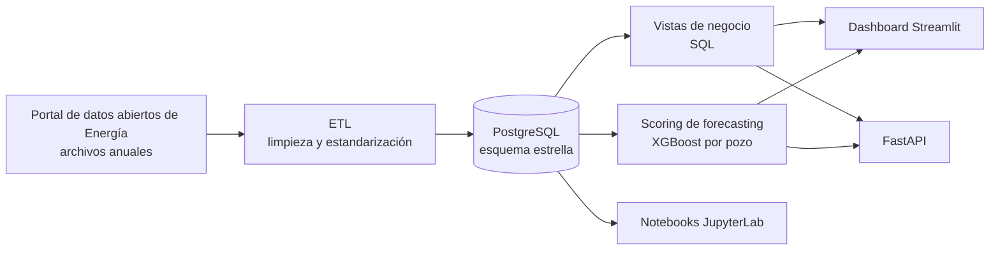

# Oil & Gas Analytics

🌐 [English](README.md) · **Español**

[](https://github.com/Mrcipo/oil_gas_analytics/actions/workflows/ci.yml)


Proyecto end-to-end de Data Engineering, Analytics y Forecasting para producción de petróleo y gas en Argentina, completamente dockerizado.

Combina:

- pipeline ETL reproducible
- data warehouse en PostgreSQL con esquema estrella
- métricas de negocio para BI
- modelo de forecasting por pozo con XGBoost
- API en FastAPI
- dashboard operativo en Streamlit
- notebooks analíticos y de modelado

## Objetivo

Construir una solución portfolio-ready para monitoreo y análisis de producción por pozo, con foco en:

- ingesta y normalización de datos públicos de energía
- modelado analítico en estrella
- explotación vía vistas SQL
- forecasting condicional por estado operativo del pozo
- exposición de resultados por API y dashboard

## Arquitectura



Flujo principal:

1. ETL por año desde el portal de datos de Energía.
2. Limpieza y estandarización en Python.
3. Carga incremental en PostgreSQL.
4. Modelado en esquema estrella.
5. Exposición de vistas de negocio.
6. Scoring de forecasting por pozo.
7. Consumo desde FastAPI, Streamlit y notebooks.

Servicios Docker:

- `db`: PostgreSQL 15 en `localhost:5437`
- `api_service`: API FastAPI en `localhost:8000`
- `notebook`: JupyterLab en `localhost:8888`
- `streamlit`: dashboard operativo en `localhost:8501`
- `etl_service`: pipeline ETL bajo perfil `etl` para ejecución explícita

## Stack Tecnológico

`Python` · `pandas` · `SQLAlchemy` · `psycopg` · `PostgreSQL` · `FastAPI` · `Streamlit` · `XGBoost` · `scikit-learn` · `pytest` · `Docker Compose` · `JupyterLab`

## Estructura del Proyecto

- `api/`: backend FastAPI
- `config/`: variables de entorno
- `data/`: datos raw, processed y external
- `docker/`: Dockerfiles auxiliares
- `notebooks/`: análisis, dashboard ejecutivo y forecasting
- `sql/`: inicialización DDL y vistas de negocio
- `src/`: ETL, features, dominio y validaciones
- `tests/`: tests unitarios con pytest
- `app.py`: dashboard Streamlit
- `docker-compose.yml`: orquestación del stack

## Puesta en Marcha

1. Crear el archivo de entorno:

```bash
cp config/.env.example config/.env
```

2. Levantar servicios principales:

```bash
docker compose up -d --build db api_service notebook streamlit
```

Servicios disponibles:

- API: `http://localhost:8000`
- Streamlit: `http://localhost:8501`
- JupyterLab: `http://localhost:8888`
- PostgreSQL: `localhost:5437`

## ETL

El ETL no arranca por defecto. Está configurado bajo `profile` para evitar recargas accidentales del pipeline.

Ejecutar ETL manualmente:

```bash
docker compose --profile etl up etl_service
```

Ejecutar ETL en background:

```bash
docker compose --profile etl up -d etl_service
```

## Modelo de Datos

El proyecto usa un esquema estrella en PostgreSQL con:

- `fact_produccion`
- `dim_empresa`
- `dim_geografia`
- `dim_pozo`
- `dim_tiempo`

Esto permite análisis por cuenca, provincia, yacimiento, empresa, pozo y fecha.

## Vistas de Negocio

`sql/business_metrics.sql` crea vistas para consumo analítico y dashboards:

- `vw_rentabilidad_cuenca_anual`
- `vw_uptime_mensual_empresa_yacimiento`
- `vw_recuperacion_secundaria_mensual`
- `vw_water_cut_mensual_pozo`
- `vw_gor_empresa_anual`
- `vw_pareto_pozos_cuenca_detalle`
- `vw_pareto_pozos_cuenca_resumen`

## Forecasting por Pozo

El forecasting usa un `XGBoost Regressor` y features temporales derivadas de la producción mensual por pozo.

Features principales:

- `target_lag_1`, `target_lag_3`, `target_lag_6`
- `target_roll_mean_6`, `target_roll_std_6`
- `edad_pozo_meses`
- `streak_ceros`
- variables one-hot de reservorio

### Mejora conceptual implementada

El pipeline fue refactorizado para separar dos problemas distintos:

1. `estado_operativo`: determinar si el pozo sigue activo
2. forecast productivo: estimar cuánto produciría solo si sigue activo

Salidas clave:

- `pred_prod_pet_modelo`: salida cruda del modelo
- `estado_operativo`: `Activo` / `Inactivo`
- `pred_prod_pet_final`: forecast final usable en la UI
- `prediccion_confiable`: bandera de confiabilidad

Regla operativa actual: un pozo se considera `Inactivo` si `prod_pet == 0`, `target_lag_1 == 0` y `target_lag_3 == 0`. En ese caso el forecast queda oculto en la UI, la línea predicha no se dibuja en el gráfico y se informa el motivo al usuario.

## Dashboard Streamlit

`app.py` permite:

- visualizar KPIs operativos
- explorar el inventario de pozos
- filtrar por cuenca y empresa
- revisar el estado operativo del pozo
- ver el forecast solo cuando aplica
- analizar el detalle de un pozo en un gráfico Real vs Predicha

Incluye parámetros económicos en el sidebar, estado de la predicción, estado operativo, motivo del forecast y lógica para ocultar predicciones no confiables.

## API FastAPI

Endpoints disponibles:

- `GET /health`
- `GET /runs`
- `GET /metrics/{cuenca}`
- `GET /predict/{pozo_id}`

Ejemplos:

```bash
curl http://localhost:8000/health
curl http://localhost:8000/metrics/Neuquina
curl http://localhost:8000/predict/132
```

## Notebooks

- `notebooks/02_executive_dashboard.ipynb`
- `notebooks/03_forecasting_declinacion.ipynb`

Cubren métricas ejecutivas, visualización analítica, feature engineering temporal, entrenamiento y validación del modelo, y análisis de importancia de variables.

## Tests

El proyecto tiene una suite de tests unitarios con `pytest`, enfocada en lógica crítica y reusable:

- `tests/test_temporal_features.py`
- `tests/test_operational_rules.py`
- `tests/test_data_quality.py`

Cobertura:

- generación correcta de lags
- no mezclar series entre pozos
- cálculo de `streak_ceros`
- regla de pozo inactivo
- forecast condicional según estado operativo
- validación de negativos en `prod_pet`
- validación de duplicados por `(id_pozo, fecha)`

Ejecutar tests:

```bash
docker compose exec -T streamlit python -m pytest /workspace/tests -v
```

Los tests también corren en cada push mediante GitHub Actions.

## Calidad de Datos

Validación reusable para datasets productivos (`src/validation/data_quality.py`) que rechaza:

- `prod_pet < 0`
- duplicados en `(id_pozo, fecha)`

## Hallazgos de Negocio

- la producción está concentrada en un subconjunto reducido de pozos
- los lags recientes explican gran parte de la dinámica productiva
- el `water cut` es útil para detectar activos maduros
- el `uptime` permite monitorear la eficiencia operativa
- separar actividad operativa de forecast productivo mejora la consistencia de negocio

## Estado Actual

El proyecto ya permite:

- levantar base y servicios con Docker
- correr el ETL manualmente
- consultar métricas vía API
- monitorear pozos desde Streamlit
- ejecutar tests unitarios
- trabajar notebooks sobre el mismo entorno reproducible

## Próximos Pasos

- reentrenar el modelo incorporando explícitamente `streak_ceros` y `estado_operativo`
- ampliar la cobertura de tests a ETL y SQL
- versionar los modelos de forecasting
- mejorar la performance del dashboard con más preagregaciones

## Licencia

[MIT](LICENSE)
