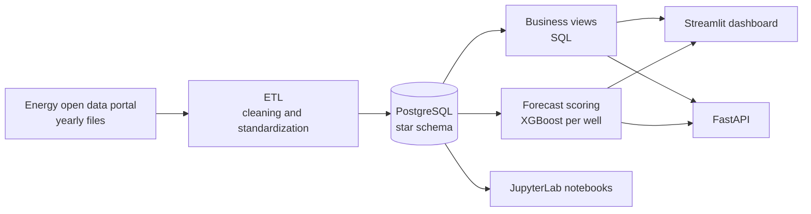

# Oil & Gas Analytics

🌐 **English** · [Español](README.es.md)

[](https://github.com/Mrcipo/oil_gas_analytics/actions/workflows/ci.yml)


End-to-end Data Engineering, Analytics and Forecasting project for oil and gas production in Argentina, fully dockerized.

It combines:

- a reproducible ETL pipeline
- a PostgreSQL data warehouse with a star schema
- business metrics for BI
- a per-well forecasting model with XGBoost
- a FastAPI service
- an operational Streamlit dashboard
- analytical and modeling notebooks

## Goal

Build a portfolio-ready solution for monitoring and analyzing production per well, focused on:

- ingestion and normalization of public energy data
- analytical modeling with a star schema
- exploitation through SQL views
- forecasting conditioned on the well's operating status
- serving results through an API and a dashboard

## Architecture



Main flow:

1. Yearly ETL from the Energy open data portal.
2. Cleaning and standardization in Python.
3. Incremental load into PostgreSQL.
4. Star schema modeling.
5. Business views exposed in SQL.
6. Per-well forecast scoring.
7. Consumption from FastAPI, Streamlit and notebooks.

Docker services:

- `db`: PostgreSQL 15 on `localhost:5437`
- `api_service`: FastAPI on `localhost:8000`
- `notebook`: JupyterLab on `localhost:8888`
- `streamlit`: operational dashboard on `localhost:8501`
- `etl_service`: ETL pipeline under the `etl` profile for explicit runs

## Tech Stack

`Python` · `pandas` · `SQLAlchemy` · `psycopg` · `PostgreSQL` · `FastAPI` · `Streamlit` · `XGBoost` · `scikit-learn` · `pytest` · `Docker Compose` · `JupyterLab`

## Project Structure

- `api/`: FastAPI backend
- `config/`: environment variables
- `data/`: raw, processed and external data
- `docker/`: auxiliary Dockerfiles
- `notebooks/`: analysis, executive dashboard and forecasting
- `sql/`: DDL initialization and business views
- `src/`: ETL, features, domain and validations
- `tests/`: unit tests with pytest
- `app.py`: Streamlit dashboard
- `docker-compose.yml`: stack orchestration

## Getting Started

1. Create the environment file:

```bash
cp config/.env.example config/.env
```

2. Start the main services:

```bash
docker compose up -d --build db api_service notebook streamlit
```

Available services:

- API: `http://localhost:8000`
- Streamlit: `http://localhost:8501`
- JupyterLab: `http://localhost:8888`
- PostgreSQL: `localhost:5437`

## ETL

The ETL does not start by default. It is configured under a Compose `profile` to avoid accidental pipeline reloads.

Run the ETL manually:

```bash
docker compose --profile etl up etl_service
```

Run the ETL in the background:

```bash
docker compose --profile etl up -d etl_service
```

## Data Model

The project uses a PostgreSQL star schema with:

- `fact_produccion`
- `dim_empresa`
- `dim_geografia`
- `dim_pozo`
- `dim_tiempo`

This enables analysis by basin, province, field, company, well and date.

## Business Views

`sql/business_metrics.sql` creates views for analytical consumption and dashboards:

- `vw_rentabilidad_cuenca_anual`
- `vw_uptime_mensual_empresa_yacimiento`
- `vw_recuperacion_secundaria_mensual`
- `vw_water_cut_mensual_pozo`
- `vw_gor_empresa_anual`
- `vw_pareto_pozos_cuenca_detalle`
- `vw_pareto_pozos_cuenca_resumen`

## Per-Well Forecasting

The forecast uses an `XGBoost Regressor` with temporal features derived from monthly production per well.

Main features:

- `target_lag_1`, `target_lag_3`, `target_lag_6`
- `target_roll_mean_6`, `target_roll_std_6`
- `edad_pozo_meses`
- `streak_ceros`
- one-hot reservoir variables

### Conceptual improvement

The pipeline was refactored to separate two distinct problems:

1. `estado_operativo`: determine whether the well is still active
2. productive forecast: estimate how much it would produce only if it remains active

Key outputs:

- `pred_prod_pet_modelo`: raw model output
- `estado_operativo`: `Activo` / `Inactivo`
- `pred_prod_pet_final`: final forecast usable in the UI
- `prediccion_confiable`: reliability flag

Current operating rule: a well is considered `Inactivo` when `prod_pet == 0`, `target_lag_1 == 0` and `target_lag_3 == 0`. In that case the forecast is hidden in the UI, the predicted line is not drawn in the chart, and the reason is shown to the user.

## Streamlit Dashboard

`app.py` lets you:

- view operational KPIs
- explore the well inventory
- filter by basin and company
- check the operating status of a well
- see the forecast only when it applies
- analyze a single well in a Real vs Predicted chart

It also includes economic parameters in the sidebar, prediction status, operating status, the reason behind the forecast, and logic to hide unreliable predictions.

> 📷 **Screenshot pending.** The dashboard needs the production data from
> [datos.energia.gob.ar](http://datos.energia.gob.ar/) loaded in PostgreSQL, so no capture is included
> yet. To add one: run the pipeline, start `streamlit run app.py`, and save the capture as
> `docs/dashboard.png`.
<!-- TODO: replace the note above with  -->

## FastAPI

Available endpoints:

- `GET /health`
- `GET /runs`
- `GET /metrics/{cuenca}`
- `GET /predict/{pozo_id}`

Examples:

```bash
curl http://localhost:8000/health
curl http://localhost:8000/metrics/Neuquina
curl http://localhost:8000/predict/132
```

## Notebooks

- `notebooks/02_executive_dashboard.ipynb`
- `notebooks/03_forecasting_declinacion.ipynb`

They cover executive metrics, analytical visualization, temporal feature engineering, model training and validation, and feature importance analysis.

## Tests

The project has a unit test suite with `pytest`, focused on critical and reusable logic:

- `tests/test_temporal_features.py`
- `tests/test_operational_rules.py`
- `tests/test_data_quality.py`

Coverage:

- correct lag generation
- series from different wells are never mixed
- `streak_ceros` calculation
- inactive-well rule
- forecast conditioned on operating status
- validation of negative `prod_pet` values
- validation of duplicates by `(id_pozo, fecha)`

Run the tests:

```bash
docker compose exec -T streamlit python -m pytest /workspace/tests -v
```

Tests also run on every push through GitHub Actions.

## Data Quality

A reusable validation for production datasets (`src/validation/data_quality.py`) that rejects:

- `prod_pet < 0`
- duplicates in `(id_pozo, fecha)`

## Business Findings

- production is concentrated in a small subset of wells
- recent lags explain a large part of production dynamics
- `water cut` is useful to detect mature assets
- `uptime` helps monitor operational efficiency
- separating operating status from productive forecast improves business consistency

## Current Status

The project can already:

- start the database and services with Docker
- run the ETL manually
- serve metrics through the API
- monitor wells from Streamlit
- run unit tests
- run notebooks on the same reproducible environment

## Next Steps

- retrain the model explicitly including `streak_ceros` and `estado_operativo`
- extend test coverage to the ETL and SQL
- version the forecasting models
- improve dashboard performance with more pre-aggregations

## License

[MIT](LICENSE)
